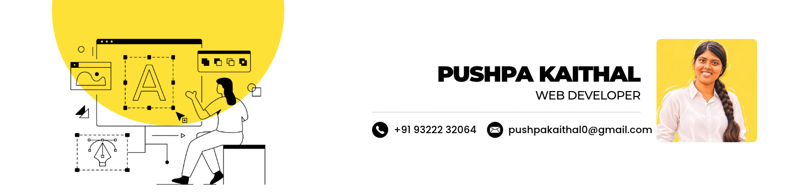

  
 <h1 align="center">Hi, I'm Pushpa Kaithal 👋</h1> 
 <b>Full Stack MERN Developer</b> &nbsp;·&nbsp; React.js &nbsp;·&nbsp; Node.js 
 
    

🚀 About Me

CS Engineering graduate (2026) who enjoys building web applications and scalable backend systems.

🔭 Building JustTap, a microservices-based service booking platform
🌱 Strengthening backend engineering, SQL and system design
🎯 Open to Full Stack, React and Backend Developer roles
📍 India · Open to relocation
🛠️ Tech Stack

  

📊 GitHub Stats

   
 
<i>Building. Learning. Creating. 🚀</i>

